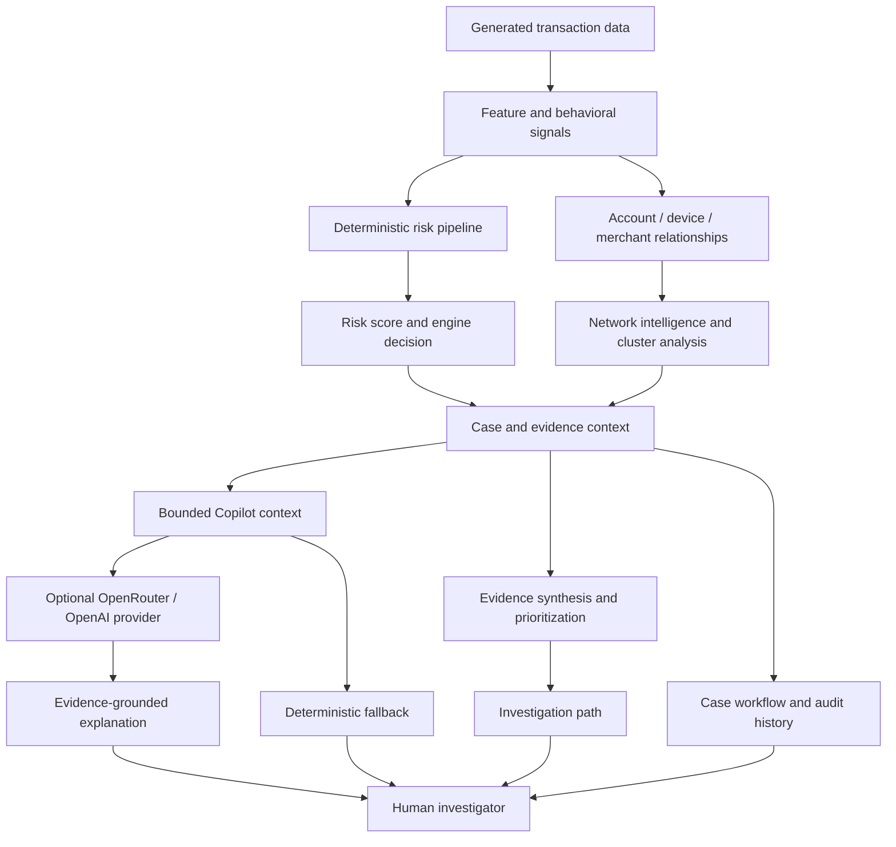

# RazorGuard
### Evidence-Grounded Fraud Risk Intelligence & Investigation Copilot

<p align="center">
  <strong>From a suspicious transaction to an explainable investigation.</strong><br/>
  Deterministic risk intelligence · Entity-network analysis · Coordinated-risk evidence · Human-led investigation · Grounded AI assistance
</p>

<p align="center">
  
  
  
  
  
  
  
</p>

**RazorGuard** is a fraud-risk investigation prototype that helps analysts move beyond a transaction-level risk score. It brings transaction and behavioral signals, account/device/merchant relationships, coordinated-risk patterns, prioritized evidence, investigator actions, audit history, and an evidence-grounded LLM copilot into one workflow.

The central design principle is deliberate: **the deterministic risk and evidence pipeline remains the source of truth; the LLM assists the human investigator but does not make or alter fraud decisions.**

> **Scope note:** RazorGuard is a portfolio/demo prototype using generated synthetic data and file-based Parquet storage. It is not a production payment control, a certified fraud model, or a substitute for review of real-world risk, compliance, and security requirements.

---

## At a glance

| Capability | What it enables |
|---|---|
| Deterministic risk workflow | Present transaction, model, behavioral, and network signals in a coherent investigation flow |
| Case operations | Search and prioritize cases, assign investigators, transition case status, and retain activity history |
| Entity-network intelligence | Explore connections across accounts, devices, merchants, and related transactions |
| Coordinated-risk analysis | Surface cluster signals such as multi-account connections, merchant concentration, and temporal bursts when supported by the available data |
| Evidence synthesis | Organize findings into **PRIMARY**, **SUPPORTING**, and **CONTEXTUAL** tiers |
| Investigation path | Present suggested next steps based on the evidence already assembled |
| Investigation Copilot | Answer analyst questions from bounded case context, with verified evidence distinguished from interpretation and suggestions |
| Resilient AI integration | Use deterministic fallback responses when an LLM provider is not configured or unavailable |
| Operational visibility | Review portfolio-level risk analytics, investigator workload, and activity history |

## Why RazorGuard?

A score can indicate risk, but it does not by itself tell an investigator what to examine, whether several entities are connected, or why multiple independent signals agree.

RazorGuard is designed around the work **after detection**:

1. **Prioritize** a suspicious case from the operational queue.
2. **Explain** the risk summary using the evidence available to the system.
3. **Explore** its account, device, merchant, and transaction relationships.
4. **Synthesize** the findings into evidence tiers and coordinated-risk context.
5. **Guide** the investigator toward useful follow-up checks.
6. **Assist** with natural-language questions without handing decision authority to the LLM.
7. **Record** investigator assignments and case-state changes in the workflow history.

The goal is not to claim that a score proves fraud. It is to make the available evidence more legible and actionable for a human reviewer.

---

## Product walkthrough

### 1. Command Center
A single operational overview for open and high-priority cases, risk distribution, queue highlights, and recent activity. It gives an investigator a starting point instead of requiring them to begin with an undifferentiated transaction list.

### 2. Case Queue
A searchable and priority-filtered queue with case identity, risk/priority, lifecycle status, assignment, and update context. Selecting a row opens the investigation workspace.

### 3. Case Investigation
A case-focused view brings together the risk summary, primary reason, evidence narrative, workflow actions, assignment, relationship exploration, coordinated-risk evidence, investigation guidance, timeline, and Copilot. The investigator can examine the reason behind the risk signal rather than treating the score as a complete explanation.

### 4. Evidence Graph V2 & Network Intelligence
Explore the transaction's surrounding entity context, including account, device, merchant, and connected entities returned by the existing network/cluster APIs. Bounded connected-entity displays help keep the investigation view readable. Relationship signals are investigative context—not proof of wrongdoing by themselves.

### 5. Coordinated-Risk Evidence
Evidence is grouped into:
- **Primary** — the strongest available reasons for the case.
- **Supporting** — corroborating signals.
- **Contextual** — background information useful to interpretation.

When distinct signals converge, the investigator can examine their explanations and associated entity context. Interpretations should still be validated against source data and operating policy.

### 6. Investigation Path & Timeline
The investigation path presents suggested next checks such as reviewing a decision, examining a cluster, investigating network risk, or inspecting related transactions. The timeline/activity views help follow assignment and case-state events. Suggestions do not automatically execute actions.

### 7. Investigation Copilot
The Copilot accepts natural-language questions such as:
- *Why was this case flagged?*
- *What is the strongest evidence?*
- *What relationships should I review?*
- *What should I investigate next?*
- *Explain the coordinated-risk cluster.*

The backend builds a bounded case-evidence context and instructs the model to use the supplied context. Responses distinguish **verified RazorGuard evidence**, **AI interpretation**, and **investigative suggestions**. The Copilot is advisory only: it does not modify risk scores, engine decisions, assignments, or case status. A deterministic fallback is available when the provider cannot answer.

### 8. Risk Analytics, Investigators & Activity
Risk Analytics summarizes aggregate case risk, model/network indicators, decisions, statuses, and dominant reasons. Investigators provides a workload-oriented view of assigned cases. Activity surfaces case-related events for operational traceability.

### 9. Settings
Workspace-facing preferences and analyst/session information. UI preferences are local to the browser where applicable; this prototype does not implement centralized identity or role-based settings management.

---

## Architecture



### System boundaries

| Layer | Responsibility |
|---|---|
| React + TypeScript + Vite | Investigator-facing operational UI |
| TanStack Query / API client | Fetching, caching, and mutation of backend resources |
| FastAPI | HTTP API, response validation, and coordination of backend services |
| Risk and graph modules | Transaction signals, network context, and coordinated-risk analysis |
| Evidence and investigation modules | Evidence tiers, convergence/context explanations, and next-step guidance |
| Copilot service | Construct bounded context, call optional LLM provider, or return deterministic fallback |
| Parquet files | Local/demo data storage for the prototype |

### Deterministic risk vs. AI assistance

**The deterministic layer owns** risk scoring, engine decisions, evidence synthesis, investigation path generation, and case lifecycle state.

**The Copilot owns none of those decisions.** It receives context assembled by RazorGuard and produces an advisory explanation. Model output should be treated as interpretation, checked against source evidence, and never treated as independent proof of fraud.

---

## Technology stack

| Area | Technologies |
|---|---|
| Frontend | React 19, TypeScript, Vite |
| Client data management | TanStack Query |
| UI icons | Lucide React |
| API | FastAPI, Pydantic |
| Data processing | Python, pandas, NumPy, PyArrow |
| Machine learning | scikit-learn |
| Storage | Parquet files |
| AI integration | OpenRouter and/or OpenAI through a backend provider abstraction |
| Tests | pytest; TypeScript/Vite production build |

---

## Repository layout

```text
razorguard/
├── src/razorguard/
│   ├── api/                 # FastAPI app, routes, request/response models
│   ├── graph/               # Transaction network and cluster intelligence
│   ├── copilot/             # Evidence context, provider abstraction, Copilot service
│   ├── investigation/       # Investigation-path logic
│   ├── ml/                  # Model training/evaluation modules
│   └── data/                # Synthetic data generation
├── frontend/
│   ├── src/
│   │   ├── components/      # Evidence graph, coordinated evidence, timeline, Copilot
│   │   ├── lib/             # API client
│   │   ├── App.tsx
│   │   └── App.css
│   └── package.json
├── tests/                   # Backend unit/API tests
├── data/                    # Generated local Parquet data
├── artifacts/               # Local model/artifact outputs
├── requirements.txt
└── README.md
```

---

## Run locally

### Prerequisites

- Python 3.11+ (Python 3.12 recommended)
- Node.js 18+ and npm
- Git

Use **two terminals** from the repository root.

### 1. Backend setup

**Windows PowerShell**

```powershell
# Activate your existing virtual environment, if present:
.\.venv\Scripts\Activate.ps1

# Otherwise create one:
python -m venv .venv
.\.venv\Scripts\Activate.ps1

pip install -r requirements.txt
```

If the repository's generated data files are absent, generate the local synthetic dataset:

```powershell
python -m razorguard.data.generate
```

Start the API from the repository root:

```powershell
uvicorn razorguard.api.app:app --reload --port 8000
```

**macOS/Linux**

```bash
python -m venv .venv
source .venv/bin/activate
pip install -r requirements.txt
python -m razorguard.data.generate
uvicorn razorguard.api.app:app --reload --port 8000
```

If the project package is not importable in your environment, install the project in editable mode from the root with `pip install -e .`. The API can then be explored through FastAPI's interactive documentation at `http://127.0.0.1:8000/docs`.

### 2. Frontend setup

In a second terminal:

```powershell
cd frontend
npm install
npm run dev
```

Open the local URL printed by Vite (typically `http://localhost:5173`). For a production build:

```powershell
npm run build
```

### 3. Optional LLM Copilot configuration

The core investigation workflow can use deterministic fallback responses without an API key. For live LLM responses, configure the provider **on the backend only**.

Create a local `.env` file in the repository root. Do not add this file to Git.

```dotenv
OPENROUTER_API_KEY=your_key_here
OPENROUTER_MODEL=openrouter/free
OPENROUTER_TIMEOUT=30

# Or use the OpenAI provider if that is the provider configured by your environment:
# OPENAI_API_KEY=your_key_here
# OPENAI_MODEL=gpt-4o-mini
# OPENAI_TIMEOUT=30
```

Run Uvicorn with the file loaded if needed:

```powershell
uvicorn razorguard.api.app:app --reload --env-file .env --port 8000
```

If Uvicorn reports that `dotenv` is missing, install `python-dotenv` in the active environment or export the variables directly in the shell. Never put provider credentials in frontend environment variables, React code, screenshots, the README, or commits. Provider/model availability, rate limits, and free-tier availability can change; the deterministic fallback remains the no-key path.

---

## Validation

The last reported local validation was:

- **Backend:** 261 pytest tests passed.
- **Frontend:** TypeScript/Vite production build passed.

Re-run validation after making changes:

```powershell
# From the repository root
pytest -q

# Frontend production build
cd frontend
npm run build
```

These results describe the last validation reported during development; run the commands in your current checkout to confirm its present state.

---

## API overview

The API routes are mounted under the versioned API prefix configured by the FastAPI application (typically `/v1`; inspect `/docs` for the exact live paths).

| Resource | Method | Purpose |
|---|---|---|
| `/network/summary` | GET | Aggregate network statistics |
| `/network/transaction/{transaction_id}` | GET | Transaction-level network context |
| `/network/transaction/{transaction_id}/cluster` | GET | Coordinated-risk cluster context |
| `/cases` | GET | Query the investigation queue |
| `/cases/{case_id}` | GET | Retrieve case details |
| `/cases/{case_id}/assign` | POST | Assign an investigator |
| `/cases/{case_id}/transition` | POST | Update case lifecycle state |
| `/cases/{case_id}/audit` | GET | Retrieve audit history |
| `/cases/{case_id}/intelligence` | GET | Retrieve investigation intelligence |
| `/copilot/status` | GET | Check Copilot provider status |
| `/copilot/ask` | POST | Ask an evidence-grounded investigation question |
| `/dashboard/summary` | GET | Command Center metrics |
| `/dashboard/distribution` | GET | Risk distribution |
| `/dashboard/activity` | GET | Recent operational activity |
| `/dashboard/queue` | GET | Priority cases |
| `/analytics/overview` | GET | Aggregate risk analytics |

The route prefix and request/response schemas are defined by the application; use `http://127.0.0.1:8000/docs` as the authoritative list for the running revision.

---

## Testing strategy

The existing test suite exercises backend behavior including risk/evidence logic, case lifecycle and API routes, and Copilot behavior. The frontend should additionally be smoke-tested manually after notable UI changes.

Recommended smoke-test sequence:

1. Open Command Center and verify summary, distribution, activity, and priority queue load.
2. Search/filter the Case Queue and open a case.
3. Inspect risk summary, evidence, and investigation actions.
4. Explore the transaction's graph and coordinated-risk context.
5. Confirm the Investigation Path and timeline render for a case.
6. Ask a Copilot question with a configured provider; also test deterministic fallback with no provider.
7. Assign a case and transition its status; verify the resulting activity/audit events.
8. Open Risk Analytics, Investigators, Activity, and Settings.
9. Run `pytest -q` and `npm run build` before publishing a change.

---

## Security and responsible-use notes

- Keep provider keys in local environment configuration; never commit them.
- Do not use production payment data or personal data in the demo.
- Treat model probabilities, risk scores, graph links, and cluster signals as decision-support signals—not conclusive proof.
- Keep a human investigator responsible for review, escalation, and final action.
- The prototype currently uses file-based data storage and does not provide production authentication/RBAC, distributed scaling, or real-time streaming.
- Before any real deployment, add a reviewed security model, database-backed persistence, access controls, data retention protections, monitoring, operational controls, and evaluation against appropriate validated datasets.

---

## Current limitations

RazorGuard is deliberately presented as a **portfolio prototype**. Known limitations include:

- Generated synthetic data rather than live transaction integrations.
- Parquet-based storage rather than a transactional production database.
- Single-process/local demo architecture; no distributed job system.
- No authentication or role-based access control.
- No real-time event streaming.
- Copilot quality and availability depend on the configured model provider; fallback output may be less flexible.
- Risk thresholds and model output require careful validation before any real financial use.

These limitations are stated explicitly so the repository does not imply a level of production readiness that has not been demonstrated.

---

## Project objective

**RazorGuard aims to make fraud investigation more explainable and actionable by connecting risk signals to evidence, relationships, and investigator next steps—while keeping AI advisory and human-led.**

Built as an engineering portfolio project by **P. Sanjayram**.

---

## License

No open-source license is currently declared. All rights remain with the repository owner unless a license is added.
